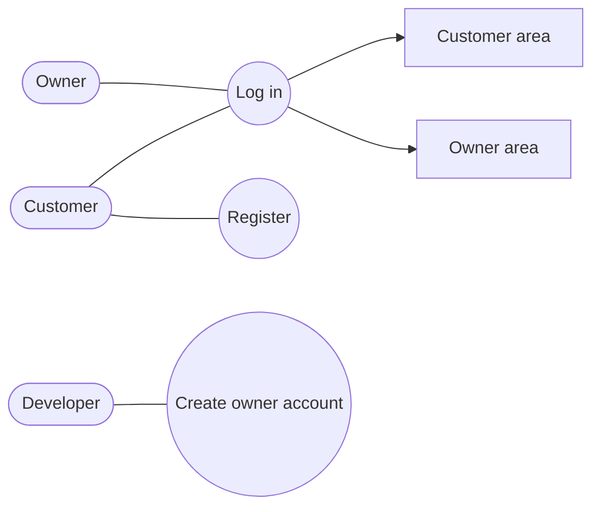

# AquaNova

A school project for Nasugbu Aquatica using React, Vite, Tailwind CSS, plain PHP, PDO, and MySQL.

## Project structure

- `src/pages/` contains shared login, customer registration, verification, password-reset, and workspace entry pages.
- `src/components/` contains shared React interface components.
- `src/lib/` contains URL and API helpers.
- `src/assets/` and `src/styles/` contain frontend images and styles.
- `api/auth/` contains small PHP endpoint entry points.
- `api/controllers/` contains authentication and endpoint handling.
- `api/services/` contains shared backend services such as SMTP email delivery.
- `private/` contains the local settings file; it is outside the generated `public/` folder and blocked by Apache.
- `database/auth_schema.sql` creates the MySQL authentication tables.
- `database/create_owner.php` creates the first owner from the command line.
- `public/` is generated by Vite. Do not edit or commit it.

The root contains the app entry point and the Vite, npm, Composer, and Apache configuration. Keep `package-lock.json` and `composer.lock` in Git so teammates install the same dependency versions.

## Setup on XAMPP

1. Start Apache and MySQL in the XAMPP Control Panel. Create a MySQL database named `aquanova` in phpMyAdmin and import `database/auth_schema.sql`. If you already have the shop's `users` table, keep it and run `database/migrations/20261106_auth_existing_users.sql` once; it adds the session version and owner role without deleting users or password hashes.
2. Copy `private/auth.example.php` to `private/auth.php`. Fill in the database and SMTP settings, set `app_url` to `http://localhost/AquaNova`, and replace `app_key` with a random 64-character hexadecimal value. Generate one with `php -r "echo bin2hex(random_bytes(32)), PHP_EOL;"`.
3. Keep `private/auth.php` out of Git. The file is ignored and direct access to `private/` is denied by Apache. Never put a mailbox password in a React file or email form.
4. Install the frontend and PHP dependencies with `npm install` and `composer install`. If Composer reports that ZIP support is unavailable, enable PHP's `zip` extension first.
5. Run `npm run dev` and `npm --prefix webapp run dev` in separate terminals, then open the website Vite URL. Its proxy forwards `/webapp/` to the webapp and API calls to the XAMPP Apache project at `http://localhost/AquaNova`.
6. To test the built site through Apache, run `npm run build`, then open `http://localhost/AquaNova/`. The `.htaccess` rules send direct page addresses such as `/login` to the React app, serve the webapp at `/webapp/`, and serve generated assets from `public/`.

Use an SMTP mailbox or provider with SMTP credentials and TLS. For example, enter the provider's host, port, username, password, and TLS mode in the ignored `private/auth.php` file. Configure a real sender mailbox; the site never signs in to a user's email account.

## Hostinger deployment

Use a PHP-capable Hostinger plan and make the project root (the folder containing `index.php` and `api/`) the web document root so the PHP endpoints can run. Install Composer dependencies and build the frontend on deployment. Import `database/auth_schema.sql`, create a production `private/auth.php` with Hostinger's MySQL/SMTP settings, set `environment` to `production` and `app_url` to the HTTPS site address, and ensure the host supports Argon2id and Apache rewrite/header rules. Set `trust_proxy_https` to `true` only if the hosting proxy replaces the `X-Forwarded-Proto` header. Verify all pages and auth endpoints use HTTPS before accepting accounts.

## Cloudflare Workers frontend with PHP backend

The Cloudflare Worker serves the built React sites from `public/` and forwards `/api/*` requests to a separately hosted PHP/MySQL backend. Cloudflare Workers do not run this project's PHP endpoints or MySQL database. Deploy the PHP project to a PHP-capable host first, with its API available at the host root (for example, `https://api.example.com/api/auth/session.php`) and HTTPS enabled.

Set `app_url` in the backend's private `auth.php` to the public Cloudflare site URL, not the PHP API host. Configure the Worker with the PHP host's HTTPS origin (origin only, with no path):

```powershell
npm install
npm run build
npx wrangler deploy
npx wrangler secret put PHP_API_ORIGIN
```

When prompted for `PHP_API_ORIGIN`, enter a value such as `https://api.example.com`. Set this secret before relying on login; until configured, API requests return an explicit 503 response. The Worker proxies the browser's same-origin API requests and session cookies to PHP. Keep the backend credentials in its private configuration and never put them in the frontend or Worker source.

For Cloudflare Workers Builds, use the repository root as the project root, `npm run build` as the build command, and `npx wrangler deploy` as the deploy command. Alternatively, `npm run deploy:cloudflare` builds and deploys from a local terminal.

The Wrangler configuration explicitly points `assets.directory` at the build output (`public/`), which is required for Workers Static Assets. This setup targets Cloudflare Workers; another platform needs its own API reverse proxy or serverless function configuration. A frontend-only deployment can display the site but cannot authenticate users without access to the PHP API and database.

## First owner account

Owner creation is a CLI-only operation. In PowerShell, enter the password at the hidden prompt, run the script, and remove the temporary environment variable:

```powershell
$secure = Read-Host "Owner password" -AsSecureString
$env:AQUANOVA_OWNER_PASSWORD = [System.Net.NetworkCredential]::new("", $secure).Password
php database\create_owner.php
Remove-Item Env:\AQUANOVA_OWNER_PASSWORD
```

The script refuses to run over HTTP and refuses to create another owner after the first one exists. The password is not embedded in source code or printed by the script. Keep the owner password in a password manager.

## Authentication flow

- `/login` accepts the account email and AquaNova password. Wrong emails and passwords share the warning `Incorrect email or password`.
- `/register` validates the new user's name, email, phone, and AquaNova-only password. It stores a password hash in `pending_registrations` and sends a six-digit email code.
- `/verify-email` checks the one-time code. Only a correct, unexpired code creates a customer row in `users`; successful registration returns to `/login`.
- `/forgot-password` sends a generic response and, for a matching account, emails a single-use reset link. `/reset-password` accepts the token from the URL fragment and submits it in the request body.
- There is one login form for both roles. Successful customers and owners go to `/webapp/`; the app checks the existing server session and calls the customer- or owner-protected endpoint before showing the matching workspace.
- `/shop` and `/dashboard` remain role-checked entry points that forward authenticated users to `/webapp/`. The owner menu is absent for customers, and the owner workspace is not protected merely by hiding a link.
- There is one login form for both roles. The authenticated database role determines whether the customer shop or owner workspace opens; registration always creates a `customer`.
- Developers provision the initial owner using `database/create_owner.php`, which refuses to add a second owner and stores an Argon2id hash. Do not distribute or keep a shared default password.
- `api/auth/` endpoints handle CSRF tokens, registration, verification/resend, login/logout, session checks, role checks, and password reset. The browser back button and direct page addresses work through Apache's front-controller rewrite.

The matching JSON endpoints are `GET csrf.php`, `GET pending.php`, `POST register.php`, `POST verify.php`, `POST resend.php`, `POST login.php`, `GET session.php`, `POST logout.php`, `POST forgot-password.php`, `POST reset-password.php`, and the protected `GET customer-page.php` / `GET owner-page.php`. They are all under `/api/auth/`.

Users never enter their Gmail or other email-account password. The sign-up password is created only for AquaNova. The email address is the login identifier (rather than a separate username), and it is used to send the verification code.

### Role and owner-account requirements

- **FR-ROLE-1:** Provide one login use case for customers and owners; route each authenticated account according to its server-verified role.
- **FR-ROLE-2:** Allow public registration only as a customer. Do not show a role selector on registration.
- **FR-ROLE-3:** Create the first owner account through a developer-only setup process, not public registration.
- **FR-ROLE-4:** Require the owner to replace a temporary password on first login before accessing owner features. This is a pending backend requirement: the current schema and auth API do not yet store or enforce a first-login password-change flag.
- **FR-ROLE-5:** Protect every owner page and action with a server-side owner-role check. The existing owner page endpoint checks the role; future owner data/action endpoints must do the same.



## Password hashing and operational security

The project uses PHP `password_hash()` with `PASSWORD_ARGON2ID`, checks with `password_verify()`, and upgrades hashes with `password_needs_rehash()` after successful logins. Current settings are centralized in `private/auth.php`: **32,768 KiB memory, 3 iterations, 1 thread**. OWASP's current minimum is 19 MiB, 2 iterations, and 1 thread; the chosen memory and iteration costs exceed that minimum while keeping parallelism at one for shared hosting. PHP's generated hash records Argon2 version `v=19` (Argon2 1.3).

Source: [OWASP Password Storage Cheat Sheet — Argon2id](https://cheatsheetseries.owasp.org/cheatsheets/Password_Storage_Cheat_Sheet.html#argon2id).

Other protections include CSRF tokens, HttpOnly/SameSite cookies, Secure cookies over HTTPS, session ID rotation, a 30-minute inactivity timeout, HMAC-hashed verification codes and hashed reset tokens, five-try login and email-code limits, resend cooldowns, role checks, prepared SQL statements, security headers, and production HTTPS redirects. Expired pending sign-ups and reset tokens are deleted automatically when the auth API connects to MySQL.

## Database tables

`database/auth_schema.sql` creates these tables in a new database. For an existing AquaNova `users` table, run `database/migrations/20261106_auth_existing_users.sql` to add the authentication fields without dropping the table:

- `users`: verified customer and owner accounts, unique normalized email, password hash, role, and session version.
- `pending_registrations`: temporary profile and password hash, code hash and expiry, wrong-try count, and resend timestamps/count.
- `login_attempts`: HMACs of account email and client address, failed-attempt windows, and lock expiry; raw addresses are not stored.
- `password_resets`: one expiring, single-use token hash per account.

The existing product/sample SQL in `database/schema.sql` is separate from this MySQL authentication schema.

## Before pushing to GitHub

- Check `git status` and confirm `private/auth.php`, `.env` files, `node_modules/`, `vendor/`, and generated `public/` files are not staged.
- The example settings file is safe to commit; put real database and SMTP credentials only in the ignored `private/auth.php`.
- Keep both dependency lockfiles (`package-lock.json` and `composer.lock`) committed. `.gitattributes` keeps text files consistently LF on Windows and other systems.
- Stage and commit from the project root:

```powershell
git add .
git status
git commit -m "Add secure account authentication"
```

Never commit a real password, app key, SMTP secret, database password, or a verification code.

## Test checklist

- [ ] Open `/login`, `/register`, and `/verify-email` directly; refresh each page and use browser Back/Forward.
- [ ] Submit a valid sign-up. Confirm the email receives a code, and that no `users` row exists until the correct code is verified.
- [ ] Confirm the pending password and final `users.password_hash` are Argon2id hashes (the final hash begins `$argon2id$v=19$m=32768,t=3,p=1$`), never plain text.
- [ ] Try a duplicate registered email with different letter case and spaces; confirm it is normalized and the duplicate warning appears.
- [ ] Enter an incorrect code, then five incorrect codes; confirm the pending sign-up is removed and must be restarted.
- [ ] Wait more than 10 minutes before verification; confirm the expired pending record is rejected and removed.
- [ ] Request a resend before 60 seconds; confirm it is denied. After 60 seconds, resend and verify that the previous code no longer works. Confirm no more than three resends per hour.
- [ ] Log in with a wrong password and an unknown email; confirm both show `Incorrect email or password`.
- [ ] Submit five failed logins for one email and, separately, from one client address; confirm the 15-minute block message. Confirm a successful login clears the counters.
- [ ] Use the website's single login as a customer and as the CLI-created owner; confirm `/webapp/` shows only the matching customer or owner navigation.
- [ ] While logged in as a customer, open `/dashboard` directly and request `/api/auth/owner-page.php`; confirm the server rejects owner access.
- [ ] Confirm customer registration has no role selector and creates only a customer account.
- [ ] Log out and confirm protected pages reject the old session. Leave a session idle for 30 minutes and confirm it expires.
- [ ] Request a forgotten password for both known and unknown emails; confirm the response text is the same. Use a valid reset link once, then confirm it cannot be reused.
- [ ] Confirm all data-changing forms send a CSRF token and reject a missing or invalid token.
- [ ] Inspect browser address bars and requests: passwords and verification codes must not be in URLs, and no screen asks for an email account password.
- [ ] In production configuration, confirm HTTP redirects to HTTPS and session cookies have the Secure attribute.
